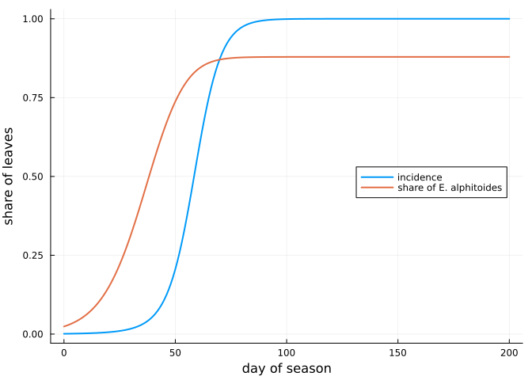
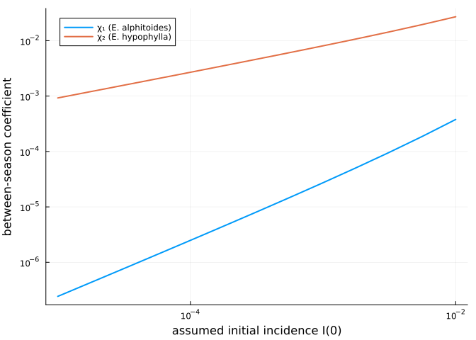

# The seasonal model of Hamelin et al. (2016)
Simon Frost

- [Overview](#overview)
- [Setup](#setup)
- [The model](#the-model)
- [Reproducing Table 2](#reproducing-table-2)
- [The annual map](#the-annual-map)
- [The likelihood](#the-likelihood)
- [What this model cannot do](#what-this-model-cannot-do)

## Overview

Two powdery mildews share the leaves of European oaks: *Erysiphe
alphitoides*, the common one, and *E. hypophylla*. Hamelin, Bisson,
Desprez-Loustau, Fabre and Mailleret (2016, *Ecosphere* 7:e01517)
explained their coexistence with a seasonal model. Within a season, both
species infect a fixed pool of susceptible leaves; between seasons, the
inoculum each carries over depends on its sporulating leaves at the end
of the season. Fitted to species frequencies at Cestas (France) in 2009
and 2014, the model gave transmission rates β and between-season
coefficients χ for each species (their Table 2).

This vignette implements the model exactly, reproduces Table 2, and
shows what the fitted values imply: every leaf ends the season infected,
and χ only restates the assumed initial incidence. The leaf-level model
of the next vignette nests this one.

## Setup

``` julia
using PowderyMildew
using Plots
using Printf
```

## The model

Within season *a*, with S the susceptible leaves and I₁, I₂ the leaves
infected by each species,

$$\frac{dS}{dt} = -S \sum_i \beta_i I_i, \qquad \frac{dI_i}{dt} = I_i(\beta_i S - \alpha),$$

over τ = 200 days. Between seasons, leaves are renewed (S₀ = 1) and the
inoculum of each species is χᵢ Iᵢ(τ). The first infections of the next
season follow from the share of leaves that escape all primary inoculum,

$$S(0) = S_0 e^{-H}, \qquad I_i(0) = S_0 (1 - e^{-H}) \frac{\chi_i I_i(\tau)}{H}, \qquad H = \sum_i \chi_i I_i(\tau).$$

`HamelinProblem` holds the within-season system and the annual map; the
rates are per day. The season of 2014, with the parameters of Table 2’s
first row, runs as follows.

``` julia
I0 = 1e-3
F0 = 0.024                            # initial share of E. alphitoides
p = HamelinParameters(; beta = [0.181, 0.083], chi = [2.75e-5, 0.008])
sol = solve(HamelinProblem(p, [F0, 1 - F0] .* I0; seasons = 3))
ts = 0:1:200
plot(ts, [incidence(sol, 1, t) for t in ts]; label = "incidence", lw = 2,
     xlabel = "day of season", ylabel = "share of leaves", legend = :right)
plot!(ts, [frequency(sol, 1, t) for t in ts]; label = "share of E. alphitoides", lw = 2)
```



The epidemic saturates by about day 100. The rarer but faster *E.
alphitoides* (β₁ ≈ 2β₂) rises from 2.4 % of infections at the start of
the season to about 88 % at its end.

## Reproducing Table 2

Table 2 reports no confidence intervals, and χ comes from the
coexistence equilibrium. If the start of each season is a fixed point of
the annual map, then χ follows in closed form from β, the initial
frequency F₀ and the initial incidence I(0):

$$\chi_i = \frac{H I_i(0)}{\sum_j I_j(0) \, I_i(\tau)}, \qquad H = -\log\Big(1 - \frac{\sum_j I_j(0)}{S_0}\Big).$$

`coexistence_chi` computes it. From each row’s rounded β, F₀ and I(0)
alone:

``` julia
table2 = [("2014", 1e-3, 0.181, 0.083, 0.024, 0.878, 2.75e-5, 0.008),
          ("2014", 4e-4, 0.196, 0.098, 0.024, 0.877, 1.12e-5, 0.003),
          ("2009", 1.4e-4, 0.312, 0.089, 0.020, 0.994, 2.82e-6, 0.025),
          ("2009", 5.6e-5, 0.316, 0.112, 0.020, 0.994, 1.59e-6, 0.010)]
println("year  I(0)     χ₁ (computed / paper)   χ₂ (computed / paper)   F_τ (computed / paper)  1 - I(τ)")
for (year, I, b1, b2, F, Fτ, c1, c2) in table2
    q = HamelinParameters(; beta = [b1, b2], chi = [0.0, 0.0])
    chi = coexistence_chi(q, [F, 1 - F] .* I)
    s = solve(HamelinProblem(HamelinParameters(; beta = q.beta, chi), [F, 1 - F] .* I))
    @printf("%s  %.1e  %.2e / %.2e     %.4f / %.3f        %.3f / %.3f         %.1e\n",
            year, I, chi[1], c1, chi[2], c2, frequency(s, 1, 200.0), Fτ, 1 - incidence(s, 1, 200.0))
end
```

    year  I(0)     χ₁ (computed / paper)   χ₂ (computed / paper)   F_τ (computed / paper)  1 - I(τ)
    2014  1.0e-03  2.73e-05 / 2.75e-05     0.0081 / 0.008        0.879 / 0.878         4.1e-11
    2014  4.0e-04  1.09e-05 / 1.12e-05     0.0033 / 0.003        0.882 / 0.877         4.9e-12
    2009  1.4e-04  2.81e-06 / 2.82e-06     0.0261 / 0.025        0.995 / 0.994         5.4e-13
    2009  5.6e-05  1.13e-06 / 1.59e-06     0.0078 / 0.010        0.993 / 0.994         6.5e-13

The closed form reproduces the paper’s χ₁, χ₂ and final frequency F_τ to
the rounding of the published β, except in the last row, whose season
ends so close to F = 1 that χ₂ ∝ 1/(1 − F_τ) magnifies that rounding.
Three conclusions follow.

- **The rates are per day.** With β per year, the frequency would not
  move within a season.
- **The fitted seasons infect every leaf.** The last column, the share
  of leaves still uninfected at the end of the season, is negligible in
  every fit. With α = 0 and a constant pool of leaves, the model
  describes species shares, not severity.
- **χ restates the assumed I(0).** Because I(τ) ≈ 1, the annual map
  gives Σᵢ χᵢ Iᵢ(τ) = H ≈ I(0), so each χᵢ is proportional to an initial
  incidence the authors fixed in advance, not to anything observed.

Holding β and F₀ at the 2014 values and varying the assumed I(0) shows
the proportionality:

``` julia
q = HamelinParameters(; beta = [0.181, 0.083], chi = [0.0, 0.0])
I0s = 10.0 .^ range(-5, -2; length = 13)
chis = [coexistence_chi(q, [F0, 1 - F0] .* I) for I in I0s]
plot(I0s, first.(chis); xscale = :log10, yscale = :log10, lw = 2, label = "χ₁ (E. alphitoides)",
     xlabel = "assumed initial incidence I(0)", ylabel = "between-season coefficient", legend = :topleft)
plot!(I0s, last.(chis); lw = 2, label = "χ₂ (E. hypophylla)")
```



Both lines have slope one: a tenfold change in the assumed I(0) changes
both coefficients tenfold, and the data on species frequencies cannot
tell them apart.

## The annual map

At the coexistence values of χ the start of the season is a fixed point,
and every season begins where the first did. With the paper’s rounded χ
instead, the start drifts slowly.

``` julia
chi_star = coexistence_chi(HamelinParameters(; beta = p.beta, chi = [0.0, 0.0]), [F0, 1 - F0] .* I0)
fixed = solve(HamelinProblem(HamelinParameters(; beta = p.beta, chi = chi_star), [F0, 1 - F0] .* I0; seasons = 3))
for s in 1:3
    u, v = fixed(s, 0.0), sol(s, 0.0)
    @printf("season %d: coexistence χ, I₁(0) = %.4e, I₂(0) = %.4e;  rounded χ, I₁(0) = %.4e, I₂(0) = %.4e\n",
            s, u[2], u[3], v[2], v[3])
end
```

    season 1: coexistence χ, I₁(0) = 2.4000e-05, I₂(0) = 9.7600e-04;  rounded χ, I₁(0) = 2.4000e-05, I₂(0) = 9.7600e-04
    season 2: coexistence χ, I₁(0) = 2.4000e-05, I₂(0) = 9.7600e-04;  rounded χ, I₁(0) = 2.4165e-05, I₂(0) = 9.6636e-04
    season 3: coexistence χ, I₁(0) = 2.4000e-05, I₂(0) = 9.7600e-04;  rounded χ, I₁(0) = 2.4205e-05, I₂(0) = 9.5456e-04

## The likelihood

Hamelin et al. fitted β by a binomial likelihood of the counts of *E.
alphitoides* among sampled colonies. `frequency_loglikelihood` evaluates
it; the Cestas counts (their Appendix S1) are not reproduced here. With
made-up counts, for illustration only:

``` julia
days = [60.0, 100.0, 140.0, 180.0]
sampled = [40, 40, 40, 40]
alphitoides = [10, 25, 31, 35]
frequency_loglikelihood(sol, fill(1, 4), days, sampled, alphitoides)
```

    -51.71245033618421

## What this model cannot do

The model has no leaf phenology, no timing of primary infection, and no
limit on infection short of every leaf. It can describe how the two
species share leaves, but not how severe an epidemic is, when it starts,
or where it spreads. The leaf-level model in [the next
vignette](02_leaf_model.md) adds those, and reduces to
this model in a tested limit.
