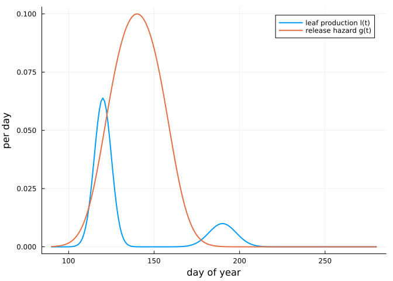
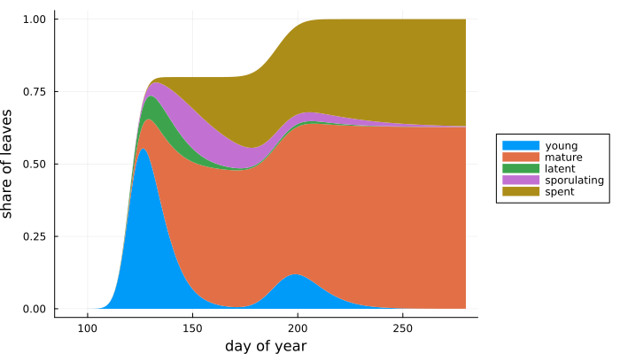
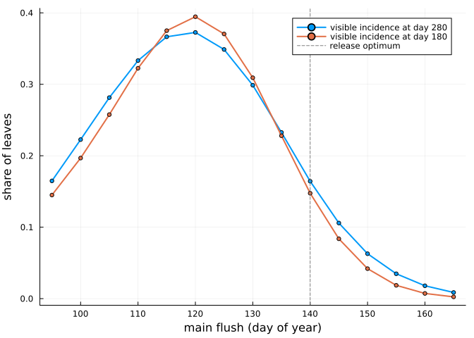
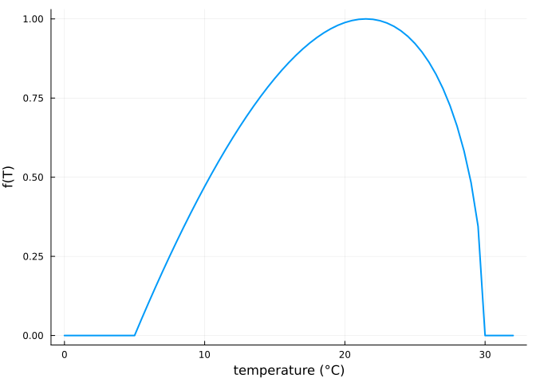
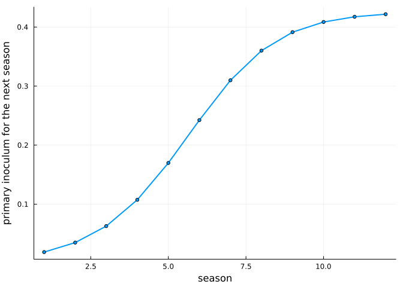

# The leaf-level model: timing and severity
Simon Frost

- [Overview](#overview)
- [Setup](#setup)
- [The model](#the-model)
- [Its parts](#its-parts)
- [Nesting Hamelin et al. (2016)](#nesting-hamelin-et-al-2016)
- [Timing sets severity](#timing-sets-severity)
- [Weather](#weather)
- [Between seasons](#between-seasons)

## Overview

Oak powdery mildew infects only young leaves: a leaf becomes resistant
within a few weeks of unfolding. Whether a season is severe therefore
depends on timing, on how well the flushing of the oaks matches the
release of the primary inoculum, ascospores from the chasmothecia that
overwintered on the bark and in the litter. Marçais, Kavkova and
Desprez-Loustau (2009) measured that release, and found it peaks in May.
Oaks that flush late, or a second flush in summer (lammas shoots), meet
the epidemic with fresh susceptible leaves.

The leaf-level model follows leaves from emergence. It keeps the
within-season secondary spread of the model of Hamelin et al. (2016),
adds leaf phenology, ageing, a latent period, a timed primary release
and weather, and carries inoculum over the winter. This vignette shows
each part, checks that the model reduces to Hamelin’s, and then asks how
the timing of flushing sets severity. **All parameter values here are
illustrative, not fitted.**

## Setup

``` julia
using PowderyMildew
using Plots
using Printf
```

## The model

For one stand, with all quantities shares of the stand’s full leaf
complement and t the day of the year:

- young susceptible leaves U₁ … U_K emerge at the rate l(t) and age
  through K stages with mean susceptible time τ_s, then become mature
  leaves M with relative susceptibility ε;
- an infected leaf is latent (E₁ … E_L, mean latent period `latent`),
  then sporulates (I), and stops sporulating at rate γ_I but stays
  diseased (Z);
- primary inoculum C is released at the hazard g(t);
- the force of infection is λ = f(t) (b_c I + b_a g(t) C + b_ext), with
  f(t) the weather.

$$\begin{aligned}
U_1' &= l(t) - (\lambda + K/\tau_s) U_1, \qquad U_k' = (K/\tau_s)(U_{k-1} - U_k) - \lambda U_k, \\
M' &= (K/\tau_s) U_K - \varepsilon \lambda M, \qquad C' = -g(t) C, \\
E_1' &= \lambda \Big(\sum_k U_k + \varepsilon M\Big) - (L/\text{latent}) E_1, \quad \dots, \quad
I' = (L/\text{latent}) E_L - \gamma_I I, \qquad Z' = \gamma_I I.
\end{aligned}$$

Next year’s primary inoculum is C = c_w ∫ η(t) I(t) dt, with η(t)
weighting the late-season sporulation that forms chasmothecia.

## Its parts

Leaf production is a sum of flushes with normally distributed dates,
which stand for the spread of flushing between trees. Here a main flush
on day 120 holds 80 % of the leaves and a lammas flush on day 190 the
rest. The release hazard is the logit-quadratic in the day of the year
of Marçais et al. (2009), with its optimum on day 140.

``` julia
production = FlushProduction([120, 190], [5, 8], [0.8, 0.2])
release = ReleaseHazard(; rate = 0.2, optimum = 140, curvature = -0.003)
days = 90:1:280
plot(days, production.(days); lw = 2, label = "leaf production l(t)", xlabel = "day of year",
     ylabel = "per day")
plot!(days, release.(days); lw = 2, label = "release hazard g(t)")
```



The parameters: secondary transmission b_c = 0.25 per day, leaves
susceptible for 20 days on average (K = 3), mature leaves 5 % as
susceptible, an 8-day latent period (L = 3), sporulation lasting 20 days
on average, and chasmothecia formed from sporulation after day 240.

``` julia
p = MildewParameters(; b_c = 0.25, b_a = 0.5, tau_s = 20, K = 3, epsilon = 0.05, latent = 8, L = 3,
                     gamma_I = 0.05, c_w = 2.0)
season(date; weather = t -> 1.0) =
    SeasonForcing(; tspan = (90, 280), production = FlushProduction([date, date + 70], [5, 8], [0.8, 0.2]),
                  release, weather, gate = t -> t > 240 ? 1.0 : 0.0, tstops = [240.0])
sol = solve(MildewProblem(p, season(120), 1.0))
# state layout with K = 3 and L = 3: [U₁ U₂ U₃ M E₁ E₂ E₃ I Z C W]
parts(t) = (u = sol(1, t); (sum(u[1:3]), u[4], sum(u[5:7]), u[8], u[9]))
P = reduce(hcat, [collect(parts(t)) for t in days])'
areaplot(days, P; label = ["young" "mature" "latent" "sporulating" "spent"], xlabel = "day of year",
         ylabel = "share of leaves", lw = 0, legend = :outerright, size = (700, 400))
```



Most infections arise on the young leaves of the main flush in May and
June. Leaves that escape mature and stay largely clean; the lammas flush
in July gives the epidemic a second crop.

## Nesting Hamelin et al. (2016)

With every leaf present at the start, no ageing, no latency, all primary
inoculum released at once and the inoculum carried over from the
sporulating leaves at the end of the season, the model is the
one-species model of Hamelin et al., with β = b_c, α = γ_I and χ = b_a
c_w.

``` julia
β, α, χ, I0, τ = 0.2, 0.03, 1.5, 1e-3, 150.0
hamelin = solve(HamelinProblem(HamelinParameters(; beta = [β], chi = [χ], alpha = α, season_length = τ), [I0];
                               seasons = 3))
b_a = 0.7
q = MildewParameters(; b_c = β, b_a, gamma_I = α, c_w = χ / b_a)
nested = solve(MildewProblem(q, fill(SeasonForcing(; tspan = (0.0, τ), leaves0 = 1.0, pulse = true), 3),
                             -log1p(-I0) / b_a))
# with K = 1 and L = 0 the state is [U M I Z C W]
gap = maximum(maximum(abs.([u[1] + u[2], u[3], u[4]] .- hamelin(s, t)))
              for s in 1:3 for t in 0:5:τ for u in (nested(s, t),))
@printf("largest difference over three seasons: %.1e\n", gap)
```

    largest difference over three seasons: 2.2e-11

## Timing sets severity

The synchrony question: how does severity depend on when the oaks flush,
relative to the release of ascospores? Shifting the main flush (and the
lammas flush with it) from day 95 to day 165, with the same primary
inoculum:

``` julia
dates = 95:5:165
runs = [solve(MildewProblem(p, season(d), 1.0)) for d in dates]
plot(dates, [visible_incidence(s, 1, 280.0) for s in runs]; lw = 2, marker = :circle, ms = 3,
     label = "visible incidence at day 280", xlabel = "main flush (day of year)", ylabel = "share of leaves")
plot!(dates, [visible_incidence(s, 1, 180.0) for s in runs]; lw = 2, marker = :circle, ms = 3,
      label = "visible incidence at day 180")
vline!([140]; color = :gray, ls = :dash, label = "release optimum")
```



Severity peaks for flushing about three weeks before the release
optimum, when young leaves are present while most ascospores are
released and the epidemic still has the summer ahead. Early-flushing
stands have mature, resistant leaves by the time release peaks;
late-flushing stands escape the primary inoculum and leave the secondary
epidemic too little time. This is the mechanism that the data of Barrès
et al. (2024) and Dantec et al. (2015) can test.

## Weather

The force of infection scales with a temperature response f(T) between 0
and 1, by default the beta function fitted to the germination of *E.
alphitoides* conidia (optimum 21.5 °C, none above 30 °C). Seasons whose
temperatures follow a smooth annual cycle around different means:

``` julia
temperature(mean) = t -> mean + 7cos(2π * (t - 200) / 365)
plot(0:0.5:32, beta_response.(0:0.5:32); lw = 2, label = nothing, xlabel = "temperature (°C)",
     ylabel = "f(T)")
```



``` julia
for mean in (11, 13, 15, 17)
    s = solve(MildewProblem(p, season(120; weather = t -> beta_response(temperature(mean)(t))), 1.0))
    @printf("annual mean %2d °C (summer peak %2d °C): visible incidence at day 280 = %.3f\n",
            mean, mean + 7, visible_incidence(s, 1, 280.0))
end
```

    annual mean 11 °C (summer peak 18 °C): visible incidence at day 280 = 0.261
    annual mean 13 °C (summer peak 20 °C): visible incidence at day 280 = 0.310
    annual mean 15 °C (summer peak 22 °C): visible incidence at day 280 = 0.344
    annual mean 17 °C (summer peak 24 °C): visible incidence at day 280 = 0.362

Warmer seasons are more severe here because temperatures stay below the
optimum. In practice, warming also shifts budburst earlier, so its net
effect depends on how flushing and release move together; the package
takes both as inputs.

## Between seasons

Chasmothecia carry the inoculum to the next year. Starting from a little
inoculum, the winter map settles towards an endemic level:

``` julia
multi = solve(MildewProblem(p, fill(season(120), 12), 0.01))
w = winter_inoculum(multi)
plot(1:12, w; lw = 2, marker = :circle, ms = 3, label = nothing, xlabel = "season",
     ylabel = "primary inoculum for the next season")
```



``` julia
@printf("growth in the first year: ×%.2f; visible incidence at day 280 in season 12: %.3f\n",
        w[1] / 0.01, visible_incidence(multi, 12, 280.0))
```

    growth in the first year: ×1.89; visible incidence at day 280 in season 12: 0.211

A low inoculum grows from one year to the next when the winter map’s
slope at zero exceeds one. That condition decides whether the disease
can establish where it arrives, and so, with the dispersal of conidia,
how fast it spreads: the subject of [the next
vignette](../03_spread/03_spread.qmd).
