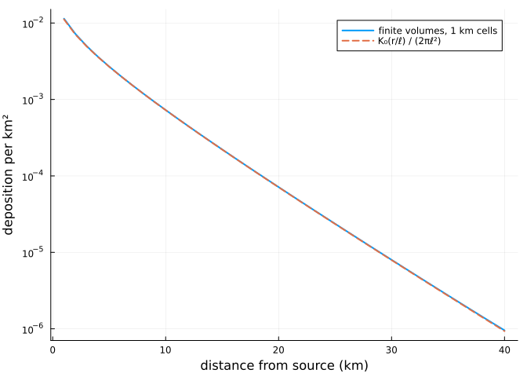
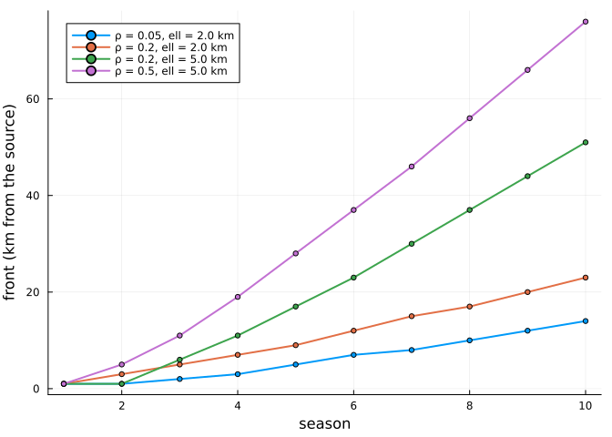
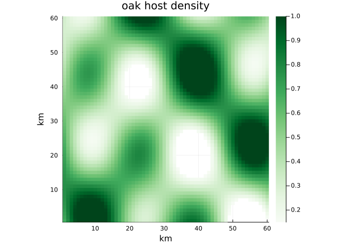
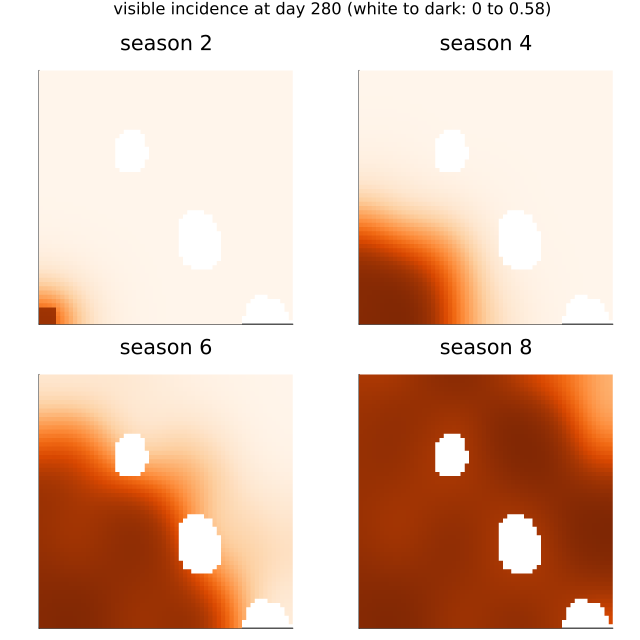
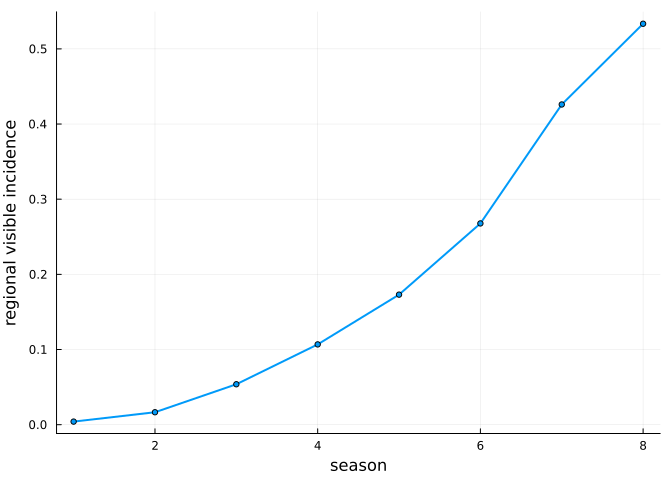

# Spread: two-scale dispersal
Simon Frost

- [Overview](#overview)
- [Setup](#setup)
- [The model](#the-model)
- [The dispersal field](#the-dispersal-field)
- [A uniform landscape is the single-stand
  model](#a-uniform-landscape-is-the-single-stand-model)
- [A front along a strip](#a-front-along-a-strip)
- [A patchy landscape](#a-patchy-landscape)
- [Next steps](#next-steps)

## Overview

*Erysiphe alphitoides* was first reported on European oaks in 1907 and
within a few years was recorded across the continent. Spread at that
pace needs some conidia to travel far, even though most infect leaves in
the canopy that produced them. The spatial model keeps both scales.
Every grid cell with oak runs the leaf-level model of [the previous
vignette](../02_leaf_model/02_leaf_model.qmd); a share 1 − ρ of the
conidia a stand produces stays in the stand, and the share ρ escapes and
is carried across the landscape over a typical distance ℓ.

This vignette shows the dispersal field, how the coupled model reduces
to the single-stand one, and how the speed of a front depends on ρ and ℓ
and on the woodland it crosses. **All parameter values are illustrative,
not fitted.**

## Setup

``` julia
using PowderyMildew
using Plots
using Printf
```

## The model

Airborne conidia survive for days at most, much less than the time an
epidemic takes to move, so the airborne field is quasi-steady. With H
the host density of each cell (its oak leaf area relative to a fully
stocked cell) and I its share of sporulating leaves, the field φ of
escaping conidia solves the screened Poisson equation with no flux
across the edge of the map,

$$(1 - \ell^2 \Delta)\, \varphi = H I,$$

and the conidial pressure on the leaves of cell i, which multiplies b_c
in the force of infection, is

$$(1 - \rho)\, I_i + \rho\, \varphi_i .$$

Primary inoculum, from chasmothecia, stays in its cell. In the plane,
the field from a point source is the kernel K₀(r/ℓ)/(2πℓ²), with K₀ the
modified Bessel function: logarithmic near the source and exponential
beyond ℓ. `dispersal_field` solves the discretised equation, by finite
volumes with one sparse Cholesky factorisation per solve.

## The dispersal field

A unit source in the middle of a 101 × 101 km grid, with ℓ = 5 km,
against the kernel in the plane:

``` julia
besselk0(x; T = 8.0, n = 4000) = (h = T / n; h * (exp(-x) / 2 + sum(exp(-x * cosh(k * h)) for k in 1:n)))
ell = 5.0
land = Landscape(ones(101, 101); cellsize = 1.0)
source = zeros(101, 101)
source[51, 51] = 1.0
φ = dispersal_field(land, ell, source)
r = 1:40
plot(r, φ[51 .+ r, 51]; yscale = :log10, lw = 2, label = "finite volumes, 1 km cells",
     xlabel = "distance from source (km)", ylabel = "deposition per km²")
plot!(r, besselk0.(r ./ ell) ./ (2π * ell^2); ls = :dash, lw = 2, label = "K₀(r/ℓ) / (2πℓ²)")
```



``` julia
@printf("deposited on the grid: %.12f of the source\n", sum(φ))
```

    deposited on the grid: 1.000000000000 of the source

The field conserves spores and matches the kernel once the cells are
small next to ℓ.

## A uniform landscape is the single-stand model

The field leaves a uniform source unchanged, so in a landscape of
uniform host density H the conidial pressure is (1 − ρ + ρH) I: the
spatial model is the single-stand model with b_c reduced by the factor 1
− ρ + ρH, whatever ℓ. A stand in sparse woodland loses the escaping
conidia and receives fewer from its neighbours. It follows that ρ and ℓ
can only be identified from spatial contrasts: a moving front, or stands
in sparse against dense woodland.

``` julia
p = MildewParameters(; b_c = 0.25, b_a = 0.5, tau_s = 20, K = 3, epsilon = 0.05, latent = 8, L = 3,
                     gamma_I = 0.05, c_w = 2.0)
release = ReleaseHazard(; rate = 0.2, optimum = 140, curvature = -0.003)
season = SeasonForcing(; tspan = (90, 280), production = FlushProduction([120, 190], [5, 8], [0.8, 0.2]),
                       release, gate = t -> t > 240 ? 1.0 : 0.0, tstops = [240.0])
rho = 0.3
for H in (1.0, 0.5, 0.2)
    spatial = solve(SpatialMildewProblem(p, Landscape(fill(H, 5, 5); cellsize = 1.0), Dispersal(; rho, ell = 3.0),
                                         fill(season, 6), 0.1))
    q = MildewParameters(; b_c = p.b_c * (1 - rho + rho * H), b_a = 0.5, tau_s = 20, K = 3, epsilon = 0.05,
                         latent = 8, L = 3, gamma_I = 0.05, c_w = 2.0)
    single = solve(MildewProblem(q, fill(season, 6), 0.1))
    @printf("H = %.1f: regional visible incidence in season 6, spatial %.4f, single stand %.4f\n", H,
            regional_incidence(spatial, 6, 280.0; visible = true), visible_incidence(single, 6, 280.0))
end
```

    H = 1.0: regional visible incidence in season 6, spatial 0.1995, single stand 0.1995
    H = 0.5: regional visible incidence in season 6, spatial 0.0597, single stand 0.0597
    H = 0.2: regional visible incidence in season 6, spatial 0.0177, single stand 0.0177

## A front along a strip

A strip of woodland 200 km long, 1 km wide and fully stocked, with
inoculum only in its first kilometre. The front is the farthest cell
whose visible incidence at the end of the season exceeds 5 %.

``` julia
strip = Landscape(ones(200, 1); cellsize = 1.0)
C0 = [1.0; zeros(199)]
nseason = 10
front(s) = [something(findlast(>(0.05), visible_incidence(s, k, 280.0)), 0) for k in 1:nseason]
cases = [(0.05, 2.0), (0.2, 2.0), (0.2, 5.0), (0.5, 5.0)]
fronts = map(cases) do (rho, ell)
    front(solve(SpatialMildewProblem(p, strip, Dispersal(; rho, ell), fill(season, nseason), C0);
                abstol = 1e-9, reltol = 1e-7))
end
plt = plot(; xlabel = "season", ylabel = "front (km from the source)", legend = :topleft)
for ((rho, ell), f) in zip(cases, fronts)
    plot!(plt, 1:nseason, f; lw = 2, marker = :circle, ms = 3, label = "ρ = $rho, ell = $ell km")
end
plt
```



After a season or two of establishment the front moves at a constant
speed, which grows with both the share of conidia that escape and the
distance they travel:

``` julia
println("   ρ    ell (km)  speed (km per year)")
for rho in (0.05, 0.1, 0.2, 0.5), ell in (1.0, 2.0, 4.0, 8.0)
    f = front(solve(SpatialMildewProblem(p, strip, Dispersal(; rho, ell), fill(season, nseason), C0);
                    abstol = 1e-9, reltol = 1e-7))
    @printf("%5.2f  %6.1f   %6.2f\n", rho, ell, (f[nseason] - f[nseason - 4]) / 4)
end
```

       ρ    ell (km)  speed (km per year)
     0.05     1.0     1.00
     0.05     2.0     1.75
     0.05     4.0     3.75
     0.05     8.0     7.50
     0.10     1.0     1.25
     0.10     2.0     2.25
     0.10     4.0     4.50
     0.10     8.0     9.00
     0.20     1.0     1.25
     0.20     2.0     2.75
     0.20     4.0     5.50
     0.20     8.0    11.00
     0.50     1.0     2.00
     0.50     2.0     3.75
     0.50     4.0     7.75
     0.50     8.0    16.00

The speed is close to proportional to ℓ and rises more slowly with ρ:
doubling ℓ doubles it, while a tenfold rise in ρ only about doubles it.
Fronts of 1 to 16 km a year are far slower than the spread across Europe
after 1907, which needs ℓ of tens of kilometres, or a kernel with a
fatter tail than the exponential one here. The historical spread,
recorded in herbarium specimens (Gross et al. 2021), is the data that
can separate those.

## A patchy landscape

Woodland is not uniform. On a 60 × 60 km landscape of patchy oak, with
inoculum seeded in one corner:

``` julia
nx = ny = 60
host = [clamp(0.55 + 0.45sin(i / 5) * cos(j / 7) + 0.25sin((i + j) / 11), 0, 1) for i in 1:nx, j in 1:ny]
host[host .< 0.15] .= 0.0
patchy = Landscape(host; cellsize = 1.0)
seed = [(i ≤ 4 && j ≤ 4) ? 1.0 : 0.0 for i in 1:nx, j in 1:ny][patchy.active]
heatmap(1:nx, 1:ny, gridded(patchy, host[patchy.active])'; c = :Greens, aspect_ratio = 1,
        xlabel = "km", ylabel = "km", title = "oak host density", xlims = (0.5, nx + 0.5), ylims = (0.5, ny + 0.5))
```



Escaping conidia are a cost as well as a means of spread: those that
land on open ground are lost, so in sparse woodland a larger ρ lowers
local transmission. For the pathogen used so far, and for a more
vigorous one (b_c = 0.35, c_w = 4), the regional visible incidence after
12 seasons:

``` julia
vigorous = MildewParameters(; b_c = 0.35, b_a = 0.5, tau_s = 20, K = 3, epsilon = 0.05, latent = 8, L = 3,
                            gamma_I = 0.05, c_w = 4.0)
println("pathogen    ρ    ell (km)  regional visible incidence, season 12")
for (name, q) in (("as above", p), ("vigorous", vigorous)), (rho, ell) in ((0.2, 4.0), (0.5, 4.0), (0.5, 8.0))
    s = solve(SpatialMildewProblem(q, patchy, Dispersal(; rho, ell), fill(season, 12), seed);
              abstol = 1e-8, reltol = 1e-6)
    @printf("%-9s  %.1f   %4.1f      %.3f\n", name, rho, ell, regional_incidence(s, 12, 280.0; visible = true))
end
```

    pathogen    ρ    ell (km)  regional visible incidence, season 12
    as above   0.2    4.0      0.029
    as above   0.5    4.0      0.012
    as above   0.5    8.0      0.005
    vigorous   0.2    4.0      0.546
    vigorous   0.5    4.0      0.475
    vigorous   0.5    8.0      0.463

The pathogen of the earlier sections barely persists in this landscape,
whose mean host density is about one half, and the more of its conidia
escape, the less it persists. The vigorous one invades whatever ρ and ℓ,
and its front, seasons 2 to 8:

``` julia
nseason2 = 8
spread = solve(SpatialMildewProblem(vigorous, patchy, Dispersal(; rho = 0.2, ell = 4.0), fill(season, nseason2),
                                    seed); abstol = 1e-8, reltol = 1e-6)
top = maximum(maximum(visible_incidence(spread, s, 280.0)) for s in 1:nseason2)
maps = [heatmap(1:nx, 1:ny, gridded(patchy, visible_incidence(spread, s, 280.0))'; c = :Oranges,
                clims = (0, top), aspect_ratio = 1, title = "season $s", colorbar = false,
                xlims = (0.5, nx + 0.5), ylims = (0.5, ny + 0.5), ticks = false)
        for s in (2, 4, 6, 8)]
plot(maps...; layout = (2, 2), size = (640, 640),
     plot_title = @sprintf("visible incidence at day 280 (white to dark: 0 to %.2f)", top), plot_titlefontsize = 11)
```



The front runs fastest through dense woodland and is slowed by sparse
woodland and gaps, and sparse stands stay less diseased once it has
passed, because they lose more of their own conidia to the open land
around them than they receive.

``` julia
plot(1:nseason2, [regional_incidence(spread, s, 280.0; visible = true) for s in 1:nseason2]; lw = 2,
     marker = :circle, ms = 3, label = nothing, xlabel = "season", ylabel = "regional visible incidence")
```



## Next steps

The model’s spread speed and severity are both set by ρ, ℓ and the
single-stand parameters, so they must be fitted together: the
within-season series (Barrès et al. 2024) for timing and severity, and
the historical front for ρ and ℓ. For Great Britain, the host grid will
come from the Copernicus tree-cover layers and the National Forest
Inventory’s oak shares, and the forcing from HadUK-Grid daily weather.
